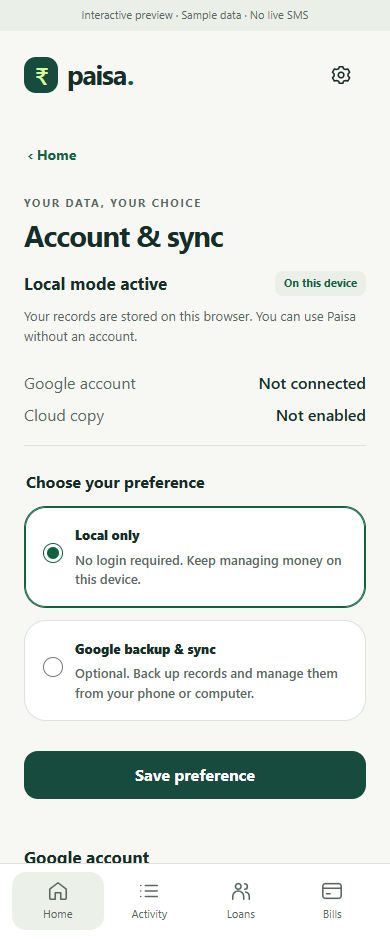
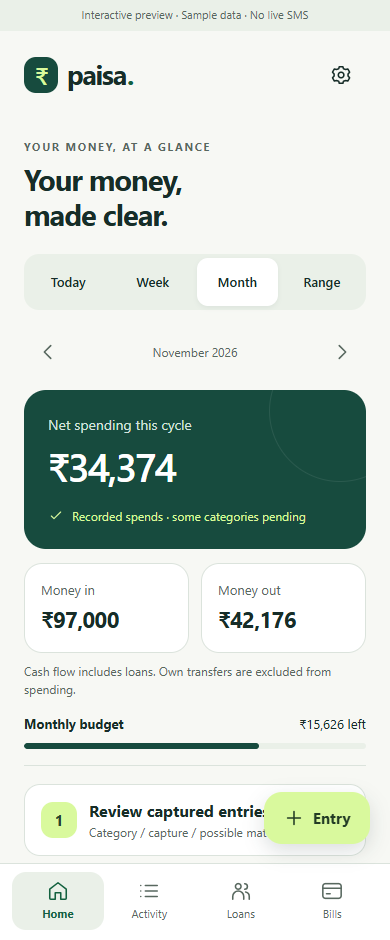
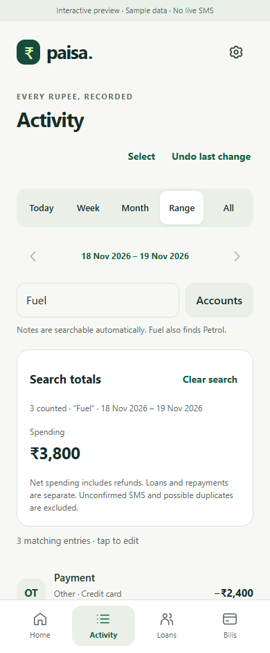

<div align="center">
  
  <h1>Paisa</h1>
  <p><strong>Your money, made clear.</strong></p>
  <p>An Android expense tracker built around less effort, useful reminders and a clean daily view.</p>
  <p>
    
    
    
    
  </p>
  <p>
    <a href="https://github.com/fuzailakhteransari/Paisa/releases/tag/v0.7.2">Download Android build</a> ·
    <a href="docs/USER_GUIDE.md">User guide</a> ·
    <a href="docs/TESTING.md">Build & test</a> ·
    <a href="CHANGELOG.md">Changelog</a>
  </p>
</div>

## Optional Google sync and web companion

**Use Paisa locally, or connect Google to manage the same records on your phone and computer.** Open Settings → Account & sync, connect Google, then explicitly choose a first backup or restore. Signing in alone never uploads your ledger. [Open Paisa web](https://paisa-fuzail.vercel.app/) · [Sync design and setup](docs/CLOUD_SYNC.md)

<p align="center"></p>

## A simple daily view

See spending today, this week or in your own monthly cycle. Review a captured payment, add a short note and remember the merchant's category. Accounts, budgets and other detailed controls stay in Settings so Home stays focused.

<p align="center">
  
  &nbsp;&nbsp;
  
</p>

<p align="center"><em>Browser previews with fictional sample data. No real financial records are shown.</em></p>

## What it does

| Area | Features |
|---|---|
| Automatic capture | Supported bank SMS, selected bank/payment-app alerts and visible Gmail payment notifications |
| Quick review | Purpose/category prompts including Other, searchable notes/tags, remembered merchant categories and duplicate review |
| Spending | Today/week/month/date-range totals, search summaries, categories, budgets and custom month start day |
| Accounts & cash | Bank/card/cash accounts, account-wise history, opening balances and ATM-to-cash transfers |
| Loans | Money lent/borrowed, partial repayments and linking an existing captured payment |
| Bills & subscriptions | Statements, utility bills, renewal schedules, payment linking and reminders |
| Optional cloud | Google identity, confirmed backups, browser editing, offline changes, conflict review and five recent cloud versions |
| Corrections & recovery | Bulk category correction/delete, conflict-aware Undo, CSV and full encrypted backup/restore |

**Gmail tracking uses visible notifications or shared/imported email text.** It does not sign into Gmail or synchronize the complete inbox. Unsupported bank formats and truncated alerts need review. Account balances reflect recorded data, rather than a live banking connection.

## Notes that work like tags

Write naturally in **Notes & tags**. Existing notes are immediately searchable; optional `#tags` work too. Open **Activity** and search a person, word or tag to see matching entries and totals.

| Search | Result |
|---|---|
| A person's name | Their mentions in notes, names and descriptions, with matching spending |
| A loan recipient | Matching spending, money lent and repayments shown separately |
| Fuel / Petrol / Peetrol | Both fuel and petrol descriptions, with refunds deducted |

Use **Today**, **Week**, **Month**, **Range** or **All** to change the reporting period. Range includes both selected dates and applies to Home totals, Activity, search and account history. Monthly budgets and bill/subscription schedules keep their own cycles and due dates.

Tags label records; choose **Money lent** or **Money borrowed** for a loan. A note does not reclassify its transaction type.

<p align="center"></p>

The HDFC `Txn Rs…` UPI card purchase fix from 0.3.2 is included. Use **Settings → Tracking & reminders → Import last 30 days** to recover recent missed supported SMS.

## Tested against the approved SMS backup

The included SMS parser was checked locally against **14,072 actual SMS**, with independent expectations and no comparison mismatches for the reviewed layouts. The audit recovered 43 missed bank events and removed 22 old false positives. The private messages, identifiers and financial exports are excluded from this repository, release archives and CI.

After updating, use **Settings → Tracking & reminders → Import last 30 days**. Untouched pending captures can be corrected safely; reviewed notes and accounting choices stay protected. Older questionable captures show **Confirm SMS entry** and stay outside totals until confirmed. Open a matching bank entry to review whether both accounts are yours before linking an own transfer.

## Install and set up

1. Download `Paisa-0.7.2-debug.apk` from [Releases](https://github.com/fuzailakhteransari/Paisa/releases/tag/v0.7.2).
2. Install on Android 8+ with an updated Android System WebView. Existing 0.1/0.2/0.3/0.3.1/0.3.2/0.4.0/0.5.1 users should install the matching signed update over the app, without uninstalling.
3. Open **Settings → Tracking & reminders** to choose optional SMS/Gmail/bank-alert access.
4. Set an opening balance under **Accounts** and an optional monthly limit under **Budgets**.
5. Create a full encrypted backup under **Backup & export** and keep its password separately.

This is a development-signed build. Real-device SMS delivery, background reminders and file-picker/upgrade behaviour still require phone testing. [Setup, accounting rules and limitations →](docs/USER_GUIDE.md)

## Privacy by design

- Financial parsing runs on the phone. Local mode makes no cloud requests. Optional Google sync uses the Paisa service; there is no analytics or ad SDK.
- SMS and Android notification access are optional. Manual tracking works without them.
- Selected-app notifications are filtered locally; imported email text is not retained.
- Full backups use authenticated password encryption. CSV exports are readable analysis files.

[Permissions and data handling →](docs/PRIVACY.md)

## Build locally

Requires **JDK 17+**, **Android SDK 35** and configured `JAVA_HOME` / `ANDROID_HOME`.

```sh
git clone https://github.com/fuzailakhteransari/Paisa.git
cd Paisa
./gradlew --no-daemon :app:assembleDebug :app:lintDebug
```

On Windows, use `gradlew.bat`. APK output: `app/build/outputs/apk/debug/app-debug.apk`.

For desktop checks, install Node.js 22+:

```sh
npm ci
npx playwright install chromium
npm test
```

The **291 checks** cover accounting, parsing, encryption/tampering, repayment links, duplicate handling, notes, Undo, persistence and responsive UI flows. Android build/lint and browser checks also run in GitHub Actions. Desktop checks do not establish real-device behaviour.

[Testing details and signing notes →](docs/TESTING.md)

## Inside the project

```text
app/src/main/
  assets/           English WebView interface and accounting helpers
  java/in/paisa/    Native capture, SQLite, reminders and recovery
  res/              App icon and Android backup-exclusion rules
docs/               User guide, architecture, privacy and testing
scripts/            Portable desktop test runners
tests/              Native domain and browser regression checks
.github/            CI and issue/PR templates
```

Native **Java + SQLite**, local **HTML/CSS/JavaScript**, no third-party runtime dependencies. Playwright and JSON-java are used only for desktop tests.

[Architecture](docs/ARCHITECTURE.md) · [Contributing](CONTRIBUTING.md) · [Security reports](SECURITY.md)
