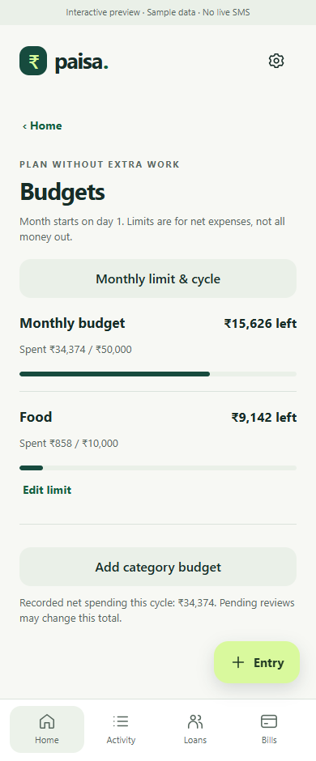

<div align="center">
  
  <h1>Paisa</h1>
  <p><strong>Your money, made clear.</strong></p>
  <p>An Android expense tracker built around less effort, useful reminders and a clean daily view.</p>
  <p>
    
    
    
    
  </p>
  <p>
    <a href="https://github.com/fuzailakhteransari/Paisa/releases/tag/v0.3.1">Download Android build</a> ·
    <a href="docs/USER_GUIDE.md">User guide</a> ·
    <a href="docs/TESTING.md">Build & test</a> ·
    <a href="CHANGELOG.md">Changelog</a>
  </p>
</div>

## A simple daily view

See spending today, this week or in your own monthly cycle. Review a captured payment, add a short note and remember the merchant's category. Accounts, budgets and other detailed controls stay in Settings so Home stays focused.

<p align="center">
  
  &nbsp;&nbsp;
  
</p>

<p align="center"><em>Browser previews with fictional sample data. No real financial records are shown.</em></p>

## What it does

| Area | Features |
|---|---|
| Automatic capture | Supported bank SMS, selected bank/payment-app alerts and visible Gmail payment notifications |
| Quick review | Purpose/category prompts, optional notes, remembered merchant categories and possible-duplicate review |
| Spending | Today/week/month totals, categories, monthly and category budgets, custom month start day |
| Accounts & cash | Bank/card/cash accounts, account-wise history, opening balances and ATM-to-cash transfers |
| Loans | Money lent/borrowed, partial repayments and linking an existing captured payment |
| Bills & subscriptions | Statements, utility bills, renewal schedules, payment linking and reminders |
| Corrections & recovery | Bulk category correction/delete, conflict-aware Undo, CSV and full encrypted backup/restore |

**Gmail tracking uses visible notifications or shared/imported email text.** It does not sign into Gmail or synchronize the complete inbox. Unsupported bank formats and truncated alerts need review. Account balances reflect recorded data, rather than a live banking connection.

## Install and set up

1. Download `Paisa-0.3.1-debug.apk` from [Releases](https://github.com/fuzailakhteransari/Paisa/releases/tag/v0.3.1).
2. Install on Android 8+ with an updated Android System WebView. Existing 0.1/0.2/0.3 users should install the matching signed update over the app, without uninstalling.
3. Open **Settings → Tracking & reminders** to choose optional SMS/Gmail/bank-alert access.
4. Set an opening balance under **Accounts** and an optional monthly limit under **Budgets**.
5. Create a full encrypted backup under **Backup & export** and keep its password separately.

This is a development-signed build. Real-device SMS delivery, background reminders and file-picker/upgrade behaviour still require phone testing. [Setup, accounting rules and limitations →](docs/USER_GUIDE.md)

## Privacy by design

- Financial parsing runs on the phone. The APK has no INTERNET permission, server, analytics or ad SDK.
- SMS and Android notification access are optional. Manual tracking works without them.
- Selected-app notifications are filtered locally; imported email text is not retained.
- Full backups use authenticated password encryption. CSV exports are readable analysis files.

[Permissions and data handling →](docs/PRIVACY.md)

## Build locally

Requires **JDK 17+**, **Android SDK 35** and configured `JAVA_HOME` / `ANDROID_HOME`.

```sh
git clone https://github.com/fuzailakhteransari/Paisa.git
cd Paisa
./gradlew --no-daemon :app:assembleDebug :app:lintDebug
```

On Windows, use `gradlew.bat`. APK output: `app/build/outputs/apk/debug/app-debug.apk`.

For desktop checks, install Node.js 22+:

```sh
npm ci
npx playwright install chromium
npm test
```

The **192 checks** cover accounting, parsing, encryption/tampering, repayment links, duplicate handling, notes, Undo, persistence and responsive UI flows. Android build/lint and browser checks also run in GitHub Actions. Desktop checks do not establish real-device behaviour.

[Testing details and signing notes →](docs/TESTING.md)

## Inside the project

```text
app/src/main/
  assets/           English WebView interface and accounting helpers
  java/in/paisa/    Native capture, SQLite, reminders and recovery
  res/              App icon and Android backup-exclusion rules
docs/               User guide, architecture, privacy and testing
scripts/            Portable desktop test runners
tests/              Native domain and browser regression checks
.github/            CI and issue/PR templates
```

Native **Java + SQLite**, local **HTML/CSS/JavaScript**, no third-party runtime dependencies. Playwright and JSON-java are used only for desktop tests.

[Architecture](docs/ARCHITECTURE.md) · [Contributing](CONTRIBUTING.md) · [Security reports](SECURITY.md)
