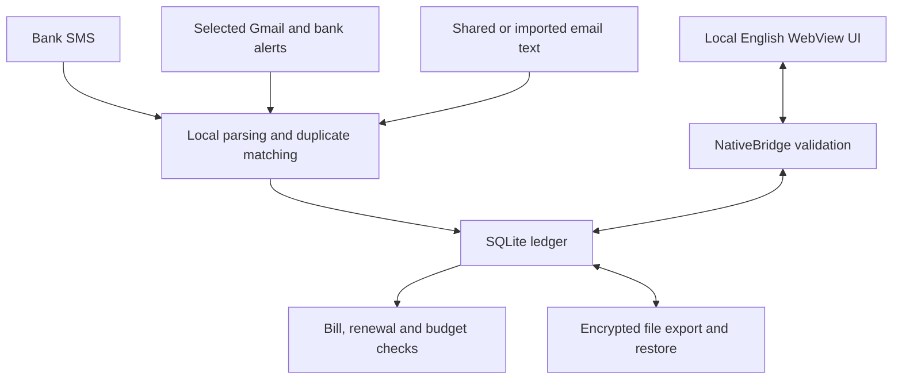

# Architecture

Paisa is a single-module Android app: native Java handles permissions, capture, persistence and file operations; a local WebView renders the interface. There are no third-party runtime libraries or network services.

## Source map

| Area | Files | Responsibility |
|---|---|---|
| UI | `index.html`, `style.css`, `app-v3.js` | Four main destinations, optional Settings tools, forms and accessibility |
| Browser accounting | `finance.js` | Preview accounting, dates, budgets and repayment allocation |
| Native bridge | `NativeBridge.java`, `MainActivity.java` | Validated mutations, permission disclosures and document picker |
| Ledger | `Ledger.java`, `Store.java` | Domain rules, SQLite migration, atomic changes and Undo |
| Capture | `Capture.java`, `SmsParser.java`, `CaptureMatcher.java` | Conservative parsing, identity matching, deduplication and category rules |
| Inputs | `SmsReceiver.java`, `CaptureService.java`, `EmailText.java`, `NoticeParser.java` | SMS, selected notification apps and common email/bill formats |
| Recovery | `BackupCipher.java`, `MutationGuard.java` | Authenticated encrypted backups and conflict-aware Undo |
| Alerts | `Reminders.java` | Inexact daily bill, subscription and budget checks |

## Accounting invariants

- Store money as integer paise. Never calculate stored amounts with floating-point currency arithmetic.
- Purchases minus refunds form net expenses. Loans, repayments and own transfers are excluded from ordinary income/expense totals.
- A card purchase is an expense. Paying its statement changes cash flow and card liability without adding another expense.
- ATM withdrawals transfer money from a bank account to Cash. Later cash spending is recorded separately.
- A linked repayment reuses the original captured payment. Partial repayments cannot exceed the corresponding loan balance.
- Subscription schedules predict dates; they do not invent completed payments.
- Possible duplicates remain visible for review and outside totals. Strong compatible reference matches can merge source evidence.

## Persistence and recovery

SQLite database version 2 upgrades previous records without dropping entries or bills. App version 0.4.0 retains the schema and application ID. Existing user notes, titles and categories are not translated or rewritten.

Mutations validate the prospective ledger before committing. Undo retains up to 20 actions, preserves later capture-source evidence and rejects conflicting later edits. Backups include the dataset and capture fingerprints; Undo history is excluded.

Backups use AES-256-GCM, PBKDF2-HMAC-SHA256 with 600,000 iterations, a random salt and nonce, and size limits. Restore authenticates and validates the file, asks before replacing records and writes an encrypted safety copy. A guarded snapshot retries if new captures arrive during preparation.

## Platform boundaries

Gmail support reads visible selected-app notification text or explicitly shared/imported content. There is no mailbox OAuth or full inbox synchronization. Parsers support common English INR formats and require real-device checks for bank-specific variations.

The WebView loads bundled assets with a restrictive CSP, network loads blocked and file/content access disabled. JavaScript is enabled for the bundled UI. The APK has no INTERNET permission. Background scheduling and permission behaviour still depend on Android and the device vendor.

## Note search and report periods

`finance.js` derives tags from original note text and matches normalized search tokens across notes, names, descriptions, categories and accounts. Optional hashtags require no separate database field. Fuel/Petrol aliases are handled locally. Full notes remain the backup/export source of truth; tags are recalculated after loading or restoring older records.

Search summaries aggregate matched active transactions, separating net expenses, loans, repayments, income and own transfers. Possible duplicates are excluded from counted totals. These are transaction-period summaries rather than a second loan balance calculation.

The custom reporting range is view state shared by Home and Activity/account-history reports. It uses local calendar midnights, an inclusive selected end date and an exclusive next-day boundary, rather than fixed 24-hour offsets. Monthly budgets and reminder due dates retain their existing domain rules.
